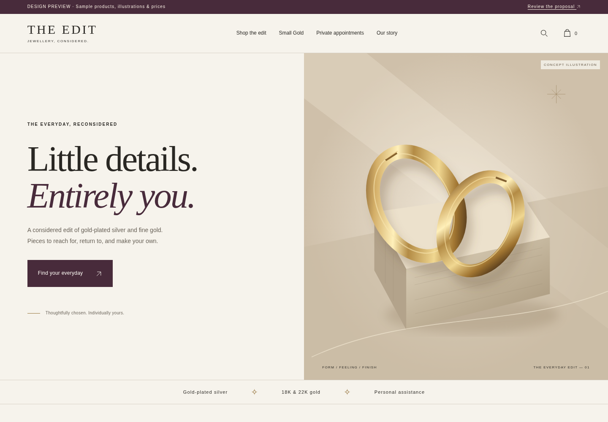

# SiteWide — PPP jewellery website

Website strategy, source research, editable budgets and an interactive jewellery storefront concept. All project files are in [`ppp/`](ppp/).

## Download and open the website

1. [Download the complete PPP review package (ZIP)](https://github.com/lazybear-p/SiteWide/raw/refs/heads/main/ppp/deliverables/ppp-website-review.zip).
2. Extract the ZIP onto your Desktop. It contains a top-level `ppp` folder.
3. Double-click `ppp/START-HERE.html`, then choose **Explore the design concept**.

No installation or account is needed to run the downloaded preview. If this repository is private, sign into GitHub to download it.

For just the website, [download `preview.html`](https://github.com/lazybear-p/SiteWide/raw/refs/heads/main/ppp/preview.html) and open it in your browser. It contains all its own styles, scripts and illustrations.

If a download link opens GitHub's file viewer, use **Download raw file**. You can also use **Code → Download ZIP** on the repository homepage; then open `SiteWide-main/ppp/START-HERE.html` after extraction. A GitHub source-file page is not a hosted website.

## Review materials

- [Founder pack: plan, research, decisions and budget (PDF)](ppp/review/founder-pack.pdf)
- [Website specification](ppp/docs/website-plan.md)
- [Official-source research](ppp/docs/research.md)
- [Confirmed and open decisions](ppp/docs/decisions.md)
- [Editable launch budget](ppp/docs/budget.csv)
- [Editable platform cost model](ppp/docs/platform-cost-model.csv)
- [Validation record](ppp/review/validation.md)

## Project status

This is a design-review prototype. **THE EDIT** is a working name; illustrations, products and prices are examples. Payments, live stock, WhatsApp and appointment delivery are not connected. No customer information is sent or saved by the prototype. The 13 recorded browser checks cover prototype behaviour, not production commerce.

The editable HTML, CSS and JavaScript are in [`ppp/prototype/`](ppp/prototype/). The self-contained `ppp/preview.html` is generated from those files. See [`ppp/README.md`](ppp/README.md) for the full folder guide and development instructions.
